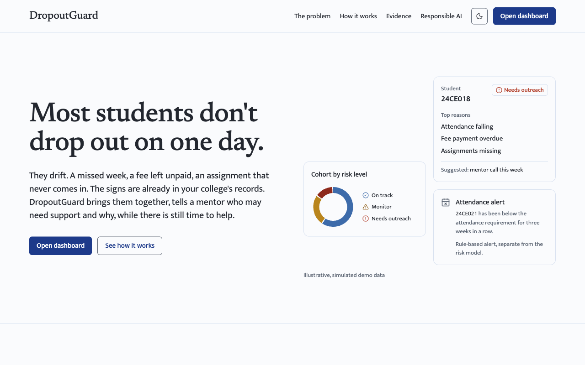
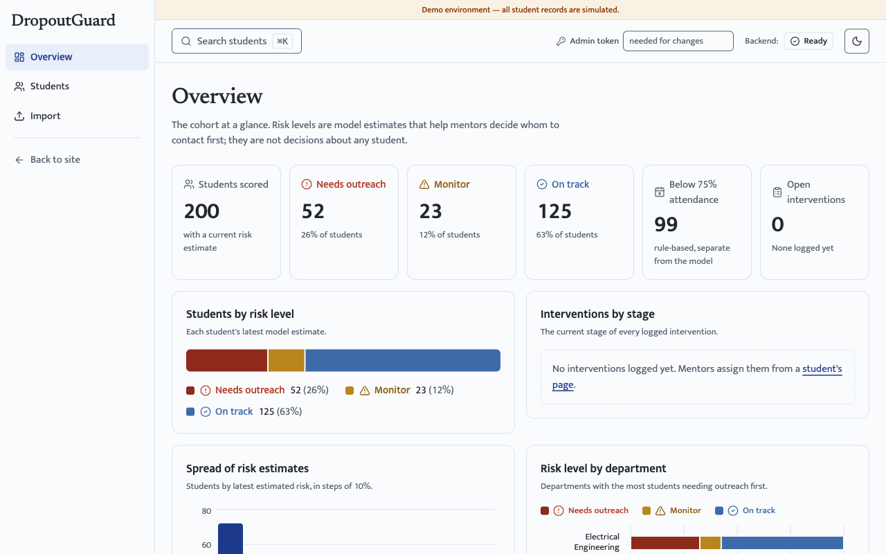
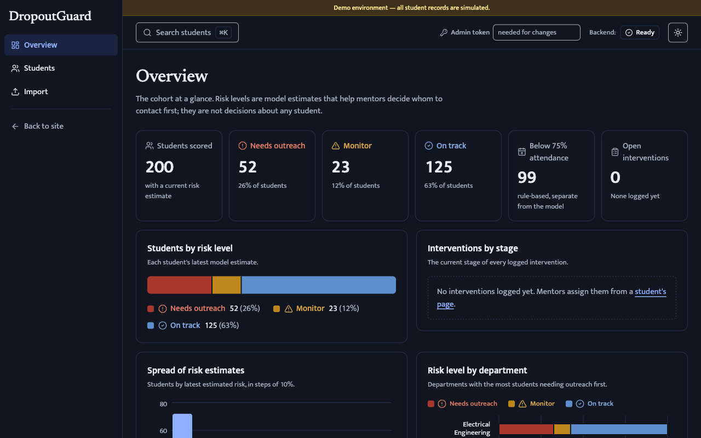
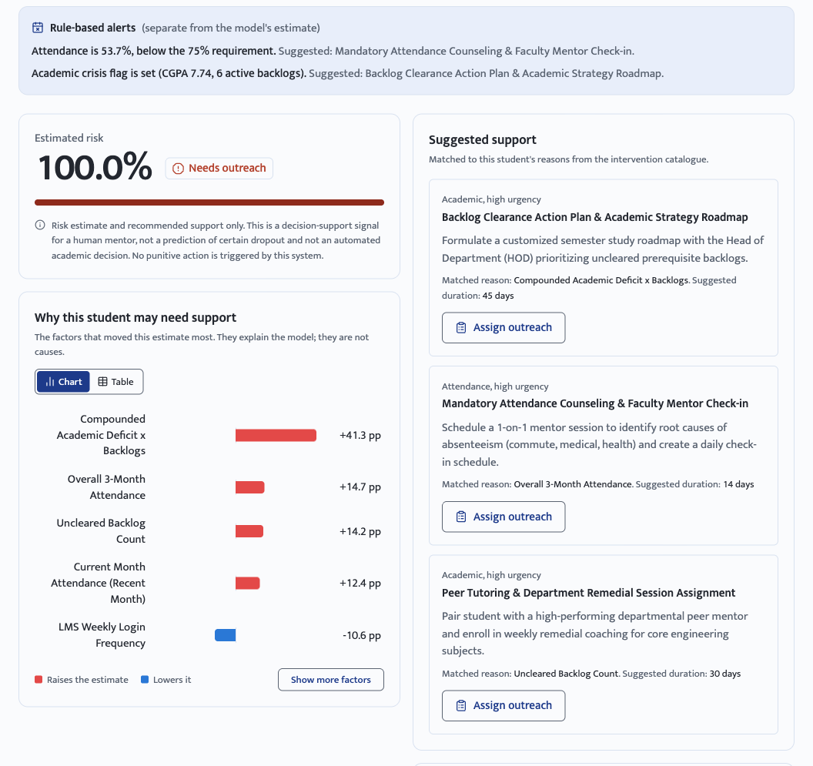
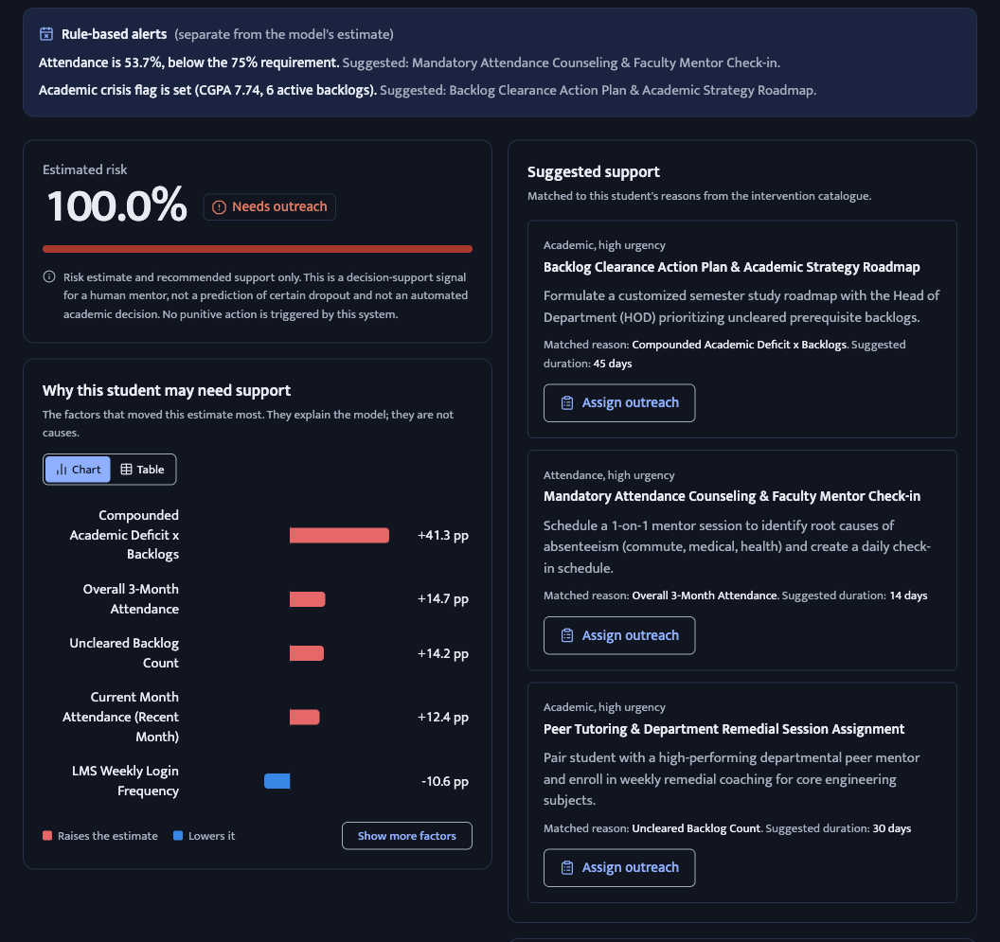
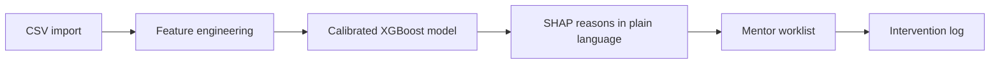

# DropoutGuard

**Early-warning and student support system for colleges.**


DropoutGuard flags students who may need support, explains each flag in plain language, suggests
interventions, and keeps a record of mentor outreach. It is decision support for mentors: nothing
it shows is punitive or automatic.



> **Status:** the demo model is trained on a simulated Indian college cohort. It has not been
> validated on Indian college records. See [Limitations](#limitations).

## 💡 Why

Most students who leave college do not leave on one day. Attendance slips, assignments stop
arriving, a fee goes unpaid, and the signs sit in separate records. India enrolled
[4.5 crore students in higher education in 2023-24](https://ddnews.gov.in/en/higher-education-enrolment-rises-to-record-4-5-crore-in-2023-24-ger-touches-30-aishe-report/)
(AISHE 2023-24, Ministry of Education, as reported by DD News), and
[33,979 students left centrally funded institutions before completing between 2019 and 2023](https://news.careers360.com/98-student-suicide-33979-dropout-iit-iim-nit-iiser-iiit-sc-st-obc-central-university-education-ministry-lok-sabha-reply)
(Ministry of Education reply in the Rajya Sabha, as reported by Careers360). DropoutGuard brings
the records a college already keeps together, so a mentor can reach out while there is still time.

## ✨ Features

- 💬 **Risk level with reasons.** Each student is on track, monitor or needs outreach, with the top reasons in plain language.
- 📋 **Mentor worklist.** Students ordered by priority and filterable by department, risk level and mentor.
- 🤝 **Interventions and logging.** Suggested actions from a catalogue of institutional interventions, and a log of every outreach and its outcome.
- 📤 **CSV import.** Upload the attendance, marks, learning-platform and fee records the college already keeps.
- 🔔 **Rule-based alerts.** Simple rules, separate from the model, raise an alert when attendance falls below the required minimum.
- ⚖️ **Fairness audits.** Results are audited across student groups, and the gaps are reported with confidence intervals.

## 🖼️ Screenshots

All records shown are simulated.

| Light | Dark |
| :---: | :---: |
|  |  |
|  |  |

## 🔄 How it works



1. **Bring the records you already have.** Upload a CSV of attendance, marks, learning-platform activity and fee status.
2. **See who may need support, and why.** Each student gets a risk level with the top reasons, not just a score.
3. **Reach out early.** Mentors work from a priority worklist with suggested actions.
4. **Record what happened.** Every outreach and outcome is logged, so the college learns what works.

## 📊 Evidence

The modelling approach is benchmarked on two public datasets with real student outcomes, UCI 697
(a Portuguese polytechnic) and OULAD (UK online learning), rebuilt from the official releases and
checked against the checksums in [ml/sources/checksums.json](ml/sources/checksums.json). The
section below is generated from the benchmark artifacts.

<!-- BENCHMARKS:START -->
Generated from `ml/artifacts/benchmarks/*.json` (commit `81f1229`; inputs `assessments.csv` `8cc738fb88ad`, `courses.csv` `4f16eee7454b`, `studentAssessment.csv` `fd5320786328`, `studentInfo.csv` `7e6f3e474a5e`, `studentRegistration.csv` `0d3267628537`, `studentVle.csv` `52668253d876`, `uci_dropout.csv` `3ef126de5cef`, `vle.csv` `d1b28303dea8`). Full results, all split strategies and metrics: [docs/benchmarks.md](docs/benchmarks.md). Values are point estimates with 95% bootstrap CIs (1,000 resamples).

#### UCI 697: Portuguese higher education

Primary label, Dropout vs Graduate (Enrolled excluded): n = 3,630, 1,421 dropouts, prevalence 0.3915. Repeated stratified 5-fold CV (3 repeats).

| Feature set | Features | Model | ROC-AUC [95% CI] | PR-AUC [95% CI] |
| :--- | ---: | :--- | :--- | :--- |
| ENROLMENT_TIME | 22 | Majority class | 0.5012 [0.4844, 0.5191] | 0.3924 [0.3747, 0.4103] |
| ENROLMENT_TIME | 22 | Logistic regression | 0.8044 [0.7896, 0.8183] | 0.7668 [0.7434, 0.7875] |
| ENROLMENT_TIME | 22 | XGBoost | 0.8516 [0.8382, 0.8644] | 0.8227 [0.8046, 0.8387] |
| END_OF_SEM1 | 28 | Majority class | 0.5012 [0.4844, 0.5191] | 0.3924 [0.3747, 0.4103] |
| END_OF_SEM1 | 28 | Logistic regression | 0.9334 [0.9242, 0.9422] | 0.9279 [0.9178, 0.9373] |
| END_OF_SEM1 | 28 | XGBoost | 0.9403 [0.9320, 0.9480] | 0.9343 [0.9250, 0.9427] |
| FULL (not early warning) | 34 | Majority class | 0.5012 [0.4844, 0.5191] | 0.3924 [0.3747, 0.4103] |
| FULL (not early warning) | 34 | Logistic regression | 0.9525 [0.9449, 0.9599] | 0.9503 [0.9427, 0.9574] |
| FULL (not early warning) | 34 | XGBoost | 0.9588 [0.9521, 0.9652] | 0.9550 [0.9480, 0.9612] |

> **Not validated on Indian college records.** This result is from a Portuguese polytechnic (UCI 697). The deployed model is trained on a simulated Indian cohort and has never been evaluated on real Indian student data.

#### OULAD: UK online learning

Label: Withdrawn. Temporal holdout: train 2013B + 2013J, test 2014B + 2014J. n = registrations still enrolled at day t.

| t (days) | n | Test n | Prevalence | Model | ROC-AUC [95% CI] | PR-AUC [95% CI] |
| ---: | ---: | ---: | ---: | :--- | :--- | :--- |
| 14 | 28,119 | 16,027 | 0.2024 | Majority class | 0.5000 [0.5000, 0.5000] | 0.2123 [0.2061, 0.2182] |
| 14 | 28,119 | 16,027 | 0.2024 | Logistic regression | 0.5909 [0.5798, 0.6016] | 0.2801 [0.2671, 0.2938] |
| 14 | 28,119 | 16,027 | 0.2024 | XGBoost | 0.5964 [0.5853, 0.6078] | 0.2832 [0.2714, 0.2978] |
| 14 | 28,119 | 16,027 | 0.2024 | GRU | 0.5963 [0.5853, 0.6071] | 0.2851 [0.2721, 0.2994] |
| 28 | 27,538 | 15,729 | 0.1855 | Majority class | 0.5000 [0.5000, 0.5000] | 0.1973 [0.1915, 0.2035] |
| 28 | 27,538 | 15,729 | 0.1855 | Logistic regression | 0.6555 [0.6442, 0.6662] | 0.3228 [0.3080, 0.3393] |
| 28 | 27,538 | 15,729 | 0.1855 | XGBoost | 0.6744 [0.6641, 0.6851] | 0.3572 [0.3405, 0.3749] |
| 28 | 27,538 | 15,729 | 0.1855 | GRU | 0.6603 [0.6494, 0.6708] | 0.3315 [0.3164, 0.3487] |
| 56 | 26,522 | 15,092 | 0.1543 | Majority class | 0.5000 [0.5000, 0.5000] | 0.1635 [0.1575, 0.1694] |
| 56 | 26,522 | 15,092 | 0.1543 | Logistic regression | 0.6645 [0.6529, 0.6756] | 0.2770 [0.2622, 0.2933] |
| 56 | 26,522 | 15,092 | 0.1543 | XGBoost | 0.6916 [0.6801, 0.7024] | 0.2863 [0.2714, 0.3018] |
| 56 | 26,522 | 15,092 | 0.1543 | GRU | 0.6884 [0.6773, 0.6988] | 0.2952 [0.2793, 0.3133] |
| 84 | 25,724 | 14,590 | 0.1281 | Majority class | 0.5000 [0.5000, 0.5000] | 0.1347 [0.1295, 0.1400] |
| 84 | 25,724 | 14,590 | 0.1281 | Logistic regression | 0.6769 [0.6641, 0.6887] | 0.2441 [0.2296, 0.2610] |
| 84 | 25,724 | 14,590 | 0.1281 | XGBoost | 0.6789 [0.6667, 0.6910] | 0.2302 [0.2171, 0.2459] |
| 84 | 25,724 | 14,590 | 0.1281 | GRU | 0.7036 [0.6919, 0.7154] | 0.2701 [0.2534, 0.2894] |

> **Not validated on Indian college records.** This result is from UK distance-learning students (OULAD). The deployed model is trained on a simulated Indian cohort and has never been evaluated on real Indian student data.
<!-- BENCHMARKS:END -->

<details>
<summary>Pipeline check on the simulated cohort (not real-world accuracy)</summary>

These figures come from the simulated cohort, whose labels follow a known formula. They show that
the pipeline runs end to end; they are not evidence of real-world accuracy. Cohort assumptions:
[docs/simulation.md](docs/simulation.md).

<!-- METRICS:START -->
- **At-Risk Recall (Sensitivity)**: `78.10%` (Minimizes missed vulnerable students)
- **At-Risk Precision**: `90.11%` (Prevents mentor alert fatigue)
- **Minority Class F1 Score**: `0.8367`
- **Macro-Averaged F1 Score**: `0.8788`
- **ROC-AUC**: `0.9325`
- **Overall Accuracy**: `89.33%`
- **Brier Calibration Score**: `0.0902`
- **Demographic Disparity**: Gender FNR gap $1.42\text{ pp}$, Economic proxy gap $8.08\text{ pp}$, First-Gen gap $7.15\text{ pp}$
<!-- METRICS:END -->

</details>

### Limitations

- **Not yet validated on Indian college records; the demo uses a simulated cohort.**
- **Shared admin token only.** Every write needs one shared bearer token (`API_ADMIN_TOKEN`), and reads are public while `PUBLIC_READ_ONLY=true`. Do not load real student data until per-mentor login exists.
- **Simulated fairness results reflect the generator's assumptions,** not disparities observed in real institutions.

## 🧰 Tech stack

| Layer | Technology | Version |
| :--- | :--- | :--- |
| ML | Python | 3.14.5 |
| ML | XGBoost · scikit-learn · SHAP | 3.4.1 · 1.9.0 · 0.52.0 |
| ML | pandas · NumPy | 3.0.5 · 2.5.2 |
| ML (research extras) | PyTorch · fairlearn | 2.14.0 · 0.14.0 |
| Backend | FastAPI · Uvicorn · Pydantic | 0.141.1 · 0.52.3 · 2.13.4 |
| Database | PostgreSQL (with `pg_trgm`) | not pinned |
| Database | SQLAlchemy · psycopg · Alembic | 2.0.52 · 3.3.4 · 1.19.1 |
| Frontend | React · React Router · TanStack Query | 19.2.8 · 7.18.2 · 5.101.4 |
| Frontend | Vite · Tailwind CSS · recharts | 8.2.1 · 3.4.19 · 3.10.1 |
| Testing | pytest · oxlint | 9.1.1 · 1.79.0 |

Python versions are pinned in [requirements.lock](requirements.lock) and frontend versions in
[frontend/package-lock.json](frontend/package-lock.json).

## 🚀 Quick start

Needs Python 3.14.5 (the version `requirements.lock` was generated with; `pyproject.toml` allows
3.11 and later), Node.js 20.19+ or 22.12+, and a PostgreSQL database.

```bash
# Python environment, exact versions from the lock file
python3 -m venv .venv
source .venv/bin/activate
pip install -r requirements.lock
pip install -e . --no-deps

# Configuration: set DATABASE_URL (required) and API_ADMIN_TOKEN (needed for any write)
cp .env.example .env

# Real-data pipeline: benchmarks, simulated-cohort model, SHAP explainer, generated docs
# (needs the raw datasets below and a clean git tree)
python -m ml.pipeline run-all --dry-run
python -m ml.pipeline run-all

# Database schema and a simulated cohort
alembic upgrade head
python -m backend.scripts.seed_students --limit 200 --predict

# API: Swagger UI at http://localhost:8000/docs
uvicorn backend.app.main:app --reload --port 8000

# Frontend, in a second terminal: http://localhost:5173
cd frontend
npm ci
npm run dev

# Tests (database tests need TEST_DATABASE_URL pointing at a throwaway database)
pytest -m "not data and not slow"
pytest verification -rs
```

**Windows:** activate with `.venv\Scripts\activate` and copy the env file with `copy .env.example .env`.

**Raw datasets for `run-all`:** extract `data.csv` unchanged from the
[UCI 697 archive](https://archive.ics.uci.edu/static/public/697/predict+students+dropout+and+academic+success.zip)
to `data/raw/uci_dropout.csv`, and the seven OULAD tables from the
[original OULAD release](https://analyse.kmi.open.ac.uk/open_dataset) into `data/raw/oulad/`.
Without them, build only the simulated-cohort model:

```bash
python -m ml.data_pipeline.feature_engineering
python -m ml.validate_pipeline --regenerate
```

More detail: [backend/README.md](backend/README.md), [frontend/README.md](frontend/README.md) and the
[API reference](docs/frontend_api_handover.md).

## 🗂️ Project structure

```
dropout-risk-ai/
├── ml/
│   ├── data_pipeline/   # simulated cohort generator and feature engineering
│   ├── sources/         # UCI 697 and OULAD loaders, the only code that reads real data
│   ├── evaluation/      # benchmark harness: splits, baselines, metrics, bootstrap CIs
│   ├── simulation/      # cohort assumptions, parameter estimation, sim-to-real check
│   ├── models/          # XGBoost training, calibration, SHAP
│   ├── intervention/    # intervention catalogue and counterfactual recourse
│   ├── fairness/        # audits, mitigations, shift check, income ablation
│   ├── artifacts/       # metrics and benchmark JSON (model binaries are gitignored)
│   └── pipeline.py      # run-all: the real-data pipeline runner
├── backend/app/         # FastAPI app: endpoints, services, models, schemas
├── alembic/versions/    # database schema migrations
├── frontend/src/        # React site and mentor app
├── scripts/             # renderers for the generated docs and README blocks
├── verification/        # audit test suite and its generated REPORT.md
└── docs/                # data dictionary, API reference, generated reports
```

## 🛡️ Responsible AI

- **A person decides; the tool only suggests.** Every flag is a prompt for a mentor to look and talk to the student.
- **Flags never punish.** They must never be used for penalties, debarment, admissions or scholarship decisions.
- **Every flag comes with its reasons.** A mentor sees why a student was flagged, in plain language, and can disagree.
- **Outcomes are audited across student groups.** Gender, age, caste category and disability are never model inputs.

Full audit: [docs/ethics_and_fairness.md](docs/ethics_and_fairness.md).

## 🗺️ Roadmap

- **Per-mentor login** to replace the shared admin token, before any real student data is loaded.
- **Validation on real Indian college data.**

## 🙌 Credits

- **Dhrupalsinh Solanki** ([@Dhrupal-01](https://github.com/Dhrupal-01)), author and maintainer.
  Designed and built the ML core: the simulated Indian college cohort and feature engineering, the
  calibrated XGBoost model with SHAP explanations, and the intervention catalogue with
  counterfactual recourse. Built the real-data benchmarks on UCI 697 and OULAD, the fairness audits
  and mitigations, and the `run-all` pipeline with artifact provenance. Added the mentor-queue and
  stats endpoints and admin-token access control to the backend, redesigned the site and mentor app,
  and wrote the verification suite.
- **Shlok Thakkar** built the first FastAPI backend: settings, database layer, the student,
  prediction and intervention-log models, and the initial schema migration.
- **Aryan Thakkar** built the first React and Vite dashboard, including the risk view with SHAP
  explanations.
